 

 

<i>「嘘を信じた者は、もう賭けに負けている。」</i>
 
whoever believes the lie has already lost the bet

  

<code>full-stack developer</code>　<code>javascript everywhere</code>

 

<pre align="center">
♠   <b>the game</b>
    I build things from the first pixel to the last query.
    Frontend, backend, everything in between.

♥   <b>bets on the table</b>
    <a href="https://github.com/eQuvilCe/MoneyPulse">MoneyPulse</a>   —  money, under control
    <a href="https://github.com/eQuvilCe/VitaPulse">VitaPulse</a>    —  AI health OS

♦   <b>house rules</b>
    Every lie gets eaten. Every bug gets found.
    Never bluff in production.
</pre>

 

  

♠　♥　♦　♣

